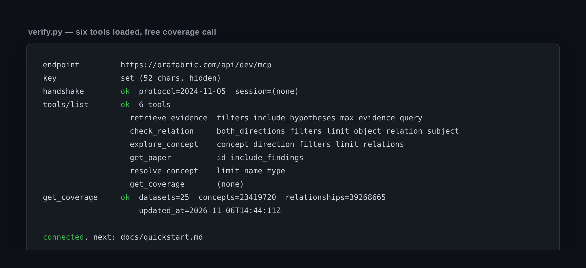
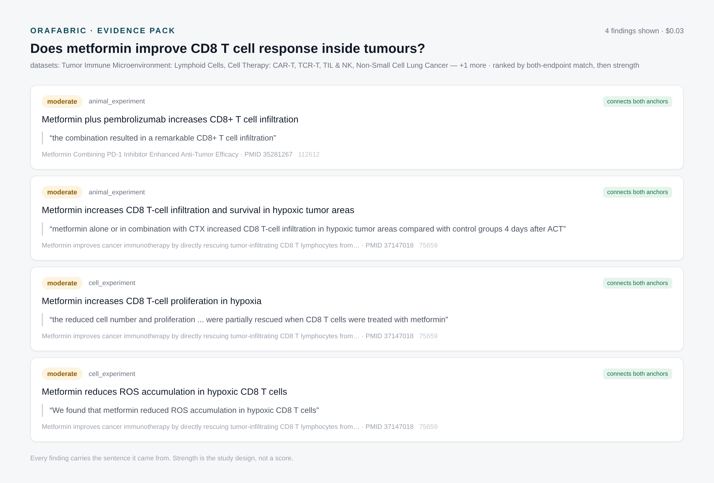
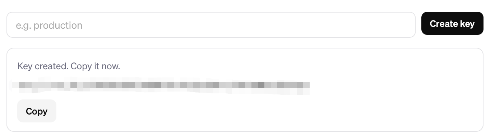

<p align="left">
  
</p>

<p align="left">
  
  
  
  
</p>

# OraFabric Medical Ontology MCP Examples

**Connect AI agents to structured biomedical knowledge.**

[OraFabric](https://orafabric.com) serves a structured biomedical knowledge graph over
MCP and HTTP. This repository contains runnable examples, integration guides and starter
projects for developers building medical AI agents, biomedical research assistants and
scientific discovery tools.

Instead of relying only on parametric LLM knowledge or unstructured literature retrieval,
your application can query assertions extracted from the biomedical literature: which paper
said what, whether it supports or contradicts a claim, what study design it used, and how
strong the evidence is.

**No dataset dumps. No server source code. No keys committed.** Just the client side.





*Both images are generated from real calls — see [`assets/capture`](assets/capture/README.md) for
the script that reproduces them.*

---

## Five minutes to your first answer

### 1. Get a key — free to start

Sign in at **<https://orafabric.com/dev/login?next=/dev>** (register + login, one page).
New accounts start with **$3.00 of credit — about 100 paid calls**, so every example in
this repository runs end to end before you pay anything.

Then press **Copy** in the console. That button copies the complete MCP configuration,
`Authorization` header included — paste it as-is and there is no key replacement step.



### 2. Drop it into your MCP client

Pasting what you copied is the whole step. If you are wiring a client by hand from the
template instead, it is one `url` and one header:

```json
{
  "mcpServers": {
    "orafabric": {
      "url": "https://orafabric.com/api/dev/mcp",
      "headers": {
        "Authorization": "Bearer YOUR_API_KEY"
      }
    }
  }
}
```

Client-specific locations are listed in [docs/mcp-configuration.md](docs/mcp-configuration.md)
(Claude Desktop, Claude Code, Cursor, VS Code, Continue, generic HTTP clients).

### 3. Ask it something

In your client:

```
Use orafabric to run get_coverage, then retrieve_evidence for
"KRAS G12C inhibitor resistance mechanisms in non-small cell lung cancer".
Show me the claim, the source sentence, the study design and the evidence strength
for every finding, and tell me which findings disagree with each other.
```

### 4. Or verify from a terminal, with no client at all

```bash
export ORAFABRIC_API_KEY=your_api_key_here
python examples/01-basic-mcp-connection/verify.py
```

```
handshake        ok  (server reports protocol 2024-11-05, no session id required)
tools/list       ok  6 tools: retrieve_evidence, check_relation, explore_concept,
                          get_paper, resolve_concept, get_coverage
get_coverage     ok  datasets=25  concepts=23,419,720  relationships=39,268,665
                      updated_at=2026-11-06T14:44:11Z
```

If that prints, you are connected. Everything else in this repository assumes exactly
this state.

---

## What can you build with it?

### 1. Biomedical knowledge retrieval

> Explore the molecular mechanisms associated with KRAS G12C.

`resolve_concept` pins the name to a node id, `retrieve_evidence` returns a pack of
findings with source sentences, and `get_paper` gives you the paper behind each finding.

### 2. Evidence-based reasoning, including disagreement

> Does current evidence support a direct causal relationship between lactate and
> CD8+ T-cell exhaustion?

The interesting output is not "yes" or "no". It is: these findings point one way, these
point the other, they differ in model system and dose, and this specific measurement has
never been reported. See [docs/evidence-semantics.md](docs/evidence-semantics.md) before
you ship any of this to a user.

### 3. Knowledge graph navigation

> Explore the neighbourhood of EGFR and find the paths that connect it to resistance
> mechanisms.

`explore_concept` walks upstream and downstream neighbours with the relation type and the
strongest evidence strength attached to each one.

---

## Tools at a glance

| Tool | What it gives you | Cost |
|---|---|---|
| `retrieve_evidence` | An evidence pack for a research question: findings, entities, edges, paths | $0.03 / call |
| `check_relation` | Evidence for, against and null on one named relationship | $0.03 / call |
| `explore_concept` | Upstream / downstream neighbourhood of a gene, drug or disease | $0.03 / call |
| `get_paper` | One paper plus the findings extracted from it | $0.03 / call |
| `resolve_concept` | Name, abbreviation or synonym matched to node ids | free |
| `get_coverage` | Current dataset, concept and relationship counts | free |

Full parameter tables and response shapes: [docs/tools-reference.md](docs/tools-reference.md).
That file also shows [what one question expands into](docs/tools-reference.md#what-one-question-expands-into)
— ten assertion-shaped searches behind a single `retrieve_evidence` call, including the
one designed to find where the effect does *not* appear.

**Build your first integration on the two free tools.** `get_coverage` tells you what is
in the graph; `resolve_concept` tells you how a name maps to it, and it is the step that
prevents most empty results.

Everything here runs on the **$3 welcome credit** (≈100 paid calls). Two free tools plus
one retrieval pack per example means the whole repository costs about $0.30 to run.

---

## Honest boundaries — read this before you build

We would rather you find these out here than in production.

- **Coverage is oncology, version 1.** The graph is being extended to general medicine;
  right now, questions outside oncology will return thin or empty packs. Call
  `get_coverage` instead of assuming.
- **This is a retrieval layer, not a chat model.** It returns structured findings. Your
  LLM writes the prose. Do not expect the server to reason for you.
- **Findings are extracted automatically.** Each finding carries its source sentence and
  paper precisely so that you can check it. Extraction can misattribute a sentence from a
  paper that was really about something else. Always render the source sentence next to
  the claim.
- **`check_relation` returns evidence buckets, not an existence verdict.** Supporting and
  contradicting counts describe how much relevant material exists, not whether the
  relationship is established. Never turn a non-zero count into "A causes B".
- **Latency is real.** A retrieval pack has been observed taking 11–50 s (47.5 s on a
  60-finding request). Set client
  timeouts to 120–180 s and show progress in your UI.
- **Calls are billed per call, $0.03.** Each example README states its own budget, and
  the welcome credit covers all of them.

Not medical advice. Not for clinical use without independent verification.

---

## Repository map

| Path | What is in it |
|---|---|
| `docs/quickstart.md` | Zero to first answer, three clients and one terminal path |
| `docs/mcp-configuration.md` | Exact config for Claude Desktop, Claude Code, Cursor, VS Code, Continue |
| `docs/tools-reference.md` | All six tools: parameters, response shapes, costs, gotchas |
| `docs/evidence-semantics.md` | How to read strength, polarity and claim type without lying to users |
| `docs/api-integration.md` | Wiring the client into a real application |
| `docs/troubleshooting.md` | Error codes we have actually hit, and what they mean |
| `examples/01-basic-mcp-connection/` | Config template + `verify.py` |
| `examples/02-biomedical-research-agent/` | A multi-step research orchestrator + prompt pack |
| `examples/03-evidence-based-reasoning/` | Disagreement-first workflow, lactate / CD8+ T cell case |
| `examples/04-python-api-integration/` | A drop-in stdlib client and an app-level integration |
| `case-studies/` | Published research produced with these tools, with reproduction steps |
| `tests/` | Transport tests, no network needed: the stream shapes a client has to survive |

---

## Case study: what this looks like as output

[`case-studies/autophagy-block-point/`](case-studies/autophagy-block-point/README.md) links
a published hypothesis report generated by multi-step traversal over this graph — [*Why
does blocking autophagy sensitise cells to some drugs but rescue them from others?*](https://doi.org/10.5281/zenodo.23904325)
(DOI 10.5281/zenodo.23904325) — together with the call log that produced it. It is the honest answer to "what does
OraFabric actually buy me that a search API does not":

- it surfaced findings that **disagree inside a single paper**,
- it located a **measurement nobody has reported**, not merely a paper nobody wrote,
- it **failed**, and the failure is documented.

Read the case study after the quickstart. It is the reason this layer exists.

---

## Who is this for

Medical AI application developers · biomedical and bioinformatics developers · AI agent
and MCP developers · scientific software teams · health-tech startups

## About OraFabric

OraFabric builds structured scientific knowledge infrastructure for AI: biomedical
literature turned into computable assertions that an agent can retrieve, compare and
reason over.

From literature to computable knowledge. From knowledge to discovery.

- Website: <https://orafabric.com>
- Developer console: <https://orafabric.com/dev/login?next=/dev>
- MCP discovery listing: <https://mcptry.com/servers/com.orafabric/medical-ontology>

## Contributing, security, licence

- [CONTRIBUTING.md](CONTRIBUTING.md) — add an example in a folder, keep it runnable, no keys.
- [SECURITY.md](SECURITY.md) — never commit a key; how to report a vulnerability.
- [LICENSE](LICENSE) — MIT for the example code only; the scope is spelled out in
  [NOTICE](NOTICE). The OraFabric service, knowledge
  base and datasets are **not** covered by that licence and remain governed by the
  OraFabric terms of service.

If something here does not run, open an issue with the output of `verify.py`. That is the
fastest path to a fix.
